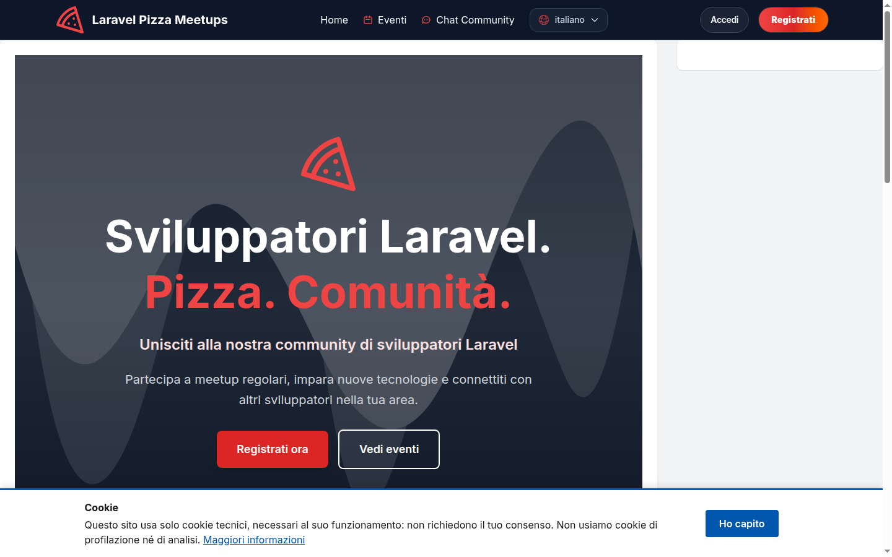

> Screenshot reale della home pubblica (superficie FO del dominio Meetup).
> I flussi utente dettagliati con riquadri stanno nel tema:
> [`Themes/Meetup/docs/manuale-utente/readme.md`](../../../../Themes/Meetup/docs/manuale-utente/readme.md).

# Modulo Meetup

## Scopo

Dominio eventi/meetup: modelli Event/Venue/…, pannello Filament Meetup, integrazioni
FO via tema. Questo manuale non ridocumenta ogni schermata già nel tema.

## Attori (sintesi verificabile)

| Attore | Dove opera |
|---|---|
| Visitatore / partecipante | FO tema Meetup (eventi, iscrizione, profilo) |
| Organizzatore / admin | Pannello Filament del modulo Meetup + risorse correlate |

## Limiti

- UI pubblica = tema, non Blade del modulo.
- Per screenshot passo-passo usare `Themes/Meetup/docs/manuale-utente/`.
